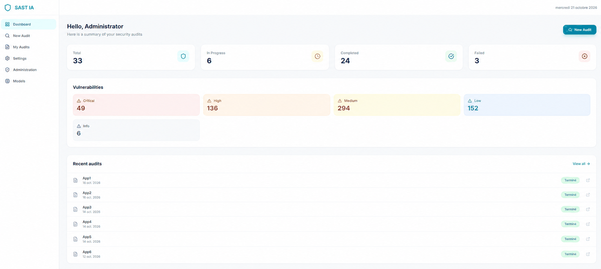

# SAST IA — Automated Security Analysis

**v0.3** — *Automatic web/native detection + VulnHunter & VulnHunter Native pipelines*

> AI-powered static analysis with adversarial verification and active Docker exploitation.



---

## Architecture

```
┌─────────────────────────────────────────────┐
│           Browser (React + Tailwind)         │
└──────────────────┬──────────────────────────┘
                   │ HTTP
                   ▼
┌─────────────────────────────────────────────┐
│           Backend (FastAPI, port 8000)        │
│  Auth │ Audits │ Reports │ Admin             │
│  SQLite/PostgreSQL                            │
└──────────────────┬──────────────────────────┘
                   │ POST /analyze
                   ▼
┌─────────────────────────────────────────────┐
│         Analysis Worker (FastAPI, port 9000)  │
│                                              │
│  1. Code Fetcher                              │
│  2. Target Detector: web | native             │
│  3. Pipeline:                                 │
│     web    → vulnhunt                         │
│     native → vulnhunt-native                  │
│     (Recon → Hunt → Verify → Reproduce →      │
│      optional Docker validation → Report)     │
│  4. Callback → backend                        │
└──────────────────────────────────────────────┘
```

---

## Quick Start

```bash
./install.sh
./start.sh
```

Open `http://localhost:5173` and login with:
- **Email**: `admin@sastia.com`
- **Password**: `admin123`

---

## What's new in v0.3

**Automatic target detection** — Before launching the manager agent, the worker
classifies the target from its file tree and a bounded content sample
(`worker/target_detection.py`):

- **web** → `vulnhunt` — HTTP apps, APIs, sites, managed services.
- **native** → `vulnhunt-native` — libraries, daemons, drivers, firmware,
  protocol parsers, anything using memory/lifetime primitives, state machines
  or IPC.

Signals include C/C++/Rust/asm sources, `malloc`/`free`/`memcpy`/`unsafe`,
kernel/driver macros (`module_init`, `copy_from_user`, `ioctl`, `DriverEntry`),
native build files, versus HTTP framework markers and web dependencies. An
explicit `analysis_type=web|native` (or `SASTIA_TARGET_TYPE`) overrides the
heuristic.

**VulnHunter Native pipeline** — state/identity inventory, invariant register,
negative space, MEM/PROTO/IDENT lenses, bounded composition of latent defects
(Phase 2c), and optional dynamic validation with ASan/UBSan/KASan.

**Unified report template** — both pipelines emit the same VulnHunter report
(VULN-NNN, Summary table, finding details, input inventory, sweep, artifacts)
and the same `report.json` schema. Native-only sections (compositions, latent
defects, coverage artifacts) are added inside that template.

## What's new in v0.2

**VulnHunter pipeline** — The legacy OWASP checklist has been replaced by the [VulnHunter](https://github.com/capitalone/VulnHunter) methodology: systematic input inventory, input-to-sink tracing, adversarial verification, codebase-wide sweep.

**Real Docker validation** — Docker no longer runs the AI's own PoC scripts. Instead, for each app type:
- **Web app**: `curl` with real payloads against the live container
- **C library**: compile with `-fsanitize=address`, run actual exploit code
- **CLI tool**: execute binary with malicious arguments

**VULN-NNN report** — One finding per sink location, CWE identifiers, summary table, resolved input inventory, code quality section.

**ZIP download** — Full report + PoCs + exploit tests in a single archive.

**Modal viewer** — In-page PoC/exploit display with raw/rendered MD toggle.

**All models compatible** — No Opus restriction.

---

## Configuration — `backend/.env`

| Variable | Default | Description |
|---|---|---|
| `SECRET_KEY` | (random at install) | JWT secret key |
| `DATABASE_URL` | `sqlite:///./sastia.db` | SQLite or PostgreSQL |
| `CORS_ORIGINS` | `http://localhost:3000,...` | Allowed origins |
| `WORKER_URL` | `http://localhost:9000` | Worker URL |
| `CODE_DOWNLOAD_BASE_URL` | `http://localhost:8000` | Public backend URL for callbacks |

Private Docker IPs (`172.x`, `192.168.x`, `10.x`) are automatically allowed by CORS middleware.

---

## API (v0.2 additions)

| Method | Endpoint | Description |
|---|---|---|
| `GET` | `/api/reports/{id}/zip` | Download full report ZIP (README + PoCs + tests) |
| `GET` | `/api/audits/{id}/artifacts/{path}` | Serve PoC / exploit test files |

---

## Project Structure (v0.2)

```
sastIA/
├── .opencode/
│   ├── agents/                    # SAST subagents
│   │   ├── sastia_manager.md      # VulnHunter orchestrator
│   │   ├── sastia_analyzer.md     # Phases 1-3 + Docker validation
│   │   ├── sastia_rapport.md      # VULN-NNN report
│   │   └── sastia_docker.md       # Docker build & cleanup
│   └── skills/
│       ├── vulnhunt/              # Web pipeline
│       │   ├── SKILL.md
│       │   └── phases/            # 11 VulnHunter phase files
│       └── vulnhunt-native/       # Native / non-web pipeline
│           ├── SKILL.md
│           ├── phases/            # Phase 0 + INJ/AUTH/MEM/PROTO/IDENT
│           ├── references/        # Archetypes, native inputs, schemas
│           └── templates/         # State/identity, invariants, latent defects
├── backend/
│   ├── app/routers/
│   │   ├── audits.py              # + artifacts endpoint
│   │   └── reports.py             # + ZIP download
│   └── app/services/
│       └── report.py              # PDF simplify + ZIP creation
├── frontend/
│   └── src/pages/
│       └── Report.tsx             # Modal viewer, ZIP, MD toggle
└── worker/
    ├── main.py                    # + skills sync, artifact collect
    ├── target_detection.py        # web vs native heuristic (auto-detection)
    └── opencode_runner.py         # web/native prompt, worker callback
```

---

## Features

| Feature | Description |
|---|---|
| **Auto detection** | Classifies web vs native before choosing the skill |
| **VulnHunter pipeline** | Web: Recon → Hunt → Verify → Report |
| **VulnHunter Native** | MEM/PROTO/IDENT lenses, state inventory, invariant register, composition |
| **Adversarial verification** | Systematic attempt to refute each finding |
| **Real Docker validation** | curl / ASAN / exec — not self-validation |
| **VULN-NNN format** | One finding per sink, with CWE |
| **ZIP download** | README + PoCs + exploit tests |
| **Modal viewer** | Raw/rendered MD toggle |
| **All models** | Works with Opus, DeepSeek, Gemini, etc. |

---

## License

MIT
