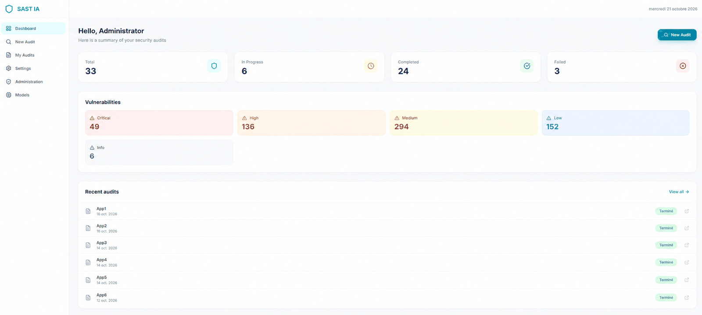

# SAST IA — Automated Security Analysis

**v0.2** — *VulnHunter pipeline + real Docker validation*

> AI-powered static analysis with adversarial verification and active Docker exploitation.



---

## Architecture

```
┌─────────────────────────────────────────────┐
│           Browser (React + Tailwind)         │
└──────────────────┬──────────────────────────┘
                   │ HTTP
                   ▼
┌─────────────────────────────────────────────┐
│           Backend (FastAPI, port 8000)        │
│  Auth │ Audits │ Reports │ Admin             │
│  SQLite/PostgreSQL                            │
└──────────────────┬──────────────────────────┘
                   │ POST /analyze
                   ▼
┌─────────────────────────────────────────────┐
│         Analysis Worker (FastAPI, port 9000)  │
│                                              │
│  1. Code Fetcher                              │
│  2. VulnHunter Pipeline:                      │
│     Phase 1  Recon → Input inventory + sinks  │
│     Phase 2  Hunt  → Trace inputs → sinks     │
│     Phase 2b Verify → Adversarial refutation  │
│     Phase 3  Reproduce/Fix/Sweep              │
│     (opt.) Docker Build + Real Exploits       │
│     Phase 4  Report (VULN-NNN + JSON)         │
│  3. Callback → backend                        │
└──────────────────────────────────────────────┘
```

---

## Quick Start

```bash
./install.sh
./start.sh
```

Open `http://localhost:5173` and login with:
- **Email**: `admin@sastia.com`
- **Password**: `admin123`

---

## What's new in v0.2

**VulnHunter pipeline** — The legacy OWASP checklist has been replaced by the [VulnHunter](https://github.com/capitalone/VulnHunter) methodology: systematic input inventory, input-to-sink tracing, adversarial verification, codebase-wide sweep.

**Real Docker validation** — Docker no longer runs the AI's own PoC scripts. Instead, for each app type:
- **Web app**: `curl` with real payloads against the live container
- **C library**: compile with `-fsanitize=address`, run actual exploit code
- **CLI tool**: execute binary with malicious arguments

**VULN-NNN report** — One finding per sink location, CWE identifiers, summary table, resolved input inventory, code quality section.

**ZIP download** — Full report + PoCs + exploit tests in a single archive.

**Modal viewer** — In-page PoC/exploit display with raw/rendered MD toggle.

**All models compatible** — No Opus restriction.

---

## Configuration — `backend/.env`

| Variable | Default | Description |
|---|---|---|
| `SECRET_KEY` | (random at install) | JWT secret key |
| `DATABASE_URL` | `sqlite:///./sastia.db` | SQLite or PostgreSQL |
| `CORS_ORIGINS` | `http://localhost:3000,...` | Allowed origins |
| `WORKER_URL` | `http://localhost:9000` | Worker URL |
| `CODE_DOWNLOAD_BASE_URL` | `http://localhost:8000` | Public backend URL for callbacks |

Private Docker IPs (`172.x`, `192.168.x`, `10.x`) are automatically allowed by CORS middleware.

---

## API (v0.2 additions)

| Method | Endpoint | Description |
|---|---|---|
| `GET` | `/api/reports/{id}/zip` | Download full report ZIP (README + PoCs + tests) |
| `GET` | `/api/audits/{id}/artifacts/{path}` | Serve PoC / exploit test files |

---

## Project Structure (v0.2)

```
sastIA/
├── .opencode/
│   ├── agents/                    # SAST subagents
│   │   ├── sastia_manager.md      # VulnHunter orchestrator
│   │   ├── sastia_analyzer.md     # Phases 1-3 + Docker validation
│   │   ├── sastia_rapport.md      # VULN-NNN report
│   │   └── sastia_docker.md       # Docker build & cleanup
│   └── skills/vulnhunt/
│       ├── SKILL.md               # Adapted (static-only, all models)
│       └── phases/                # 11 VulnHunter phase files
├── backend/
│   ├── app/routers/
│   │   ├── audits.py              # + artifacts endpoint
│   │   └── reports.py             # + ZIP download
│   └── app/services/
│       └── report.py              # PDF simplify + ZIP creation
├── frontend/
│   └── src/pages/
│       └── Report.tsx             # Modal viewer, ZIP, MD toggle
└── worker/
    ├── main.py                    # + skills sync, artifact collect
    └── opencode_runner.py         # VulnHunter prompt, worker callback
```

---

## Features

| Feature | Description |
|---|---|
| **VulnHunter pipeline** | 4 phases: Recon → Hunt → Verify → Report |
| **Adversarial verification** | Systematic attempt to refute each finding |
| **Real Docker validation** | curl / ASAN / exec — not self-validation |
| **VULN-NNN format** | One finding per sink, with CWE |
| **ZIP download** | README + PoCs + exploit tests |
| **Modal viewer** | Raw/rendered MD toggle |
| **All models** | Works with Opus, DeepSeek, Gemini, etc. |

---

## License

MIT
